# Mini-projet 2 : Application Task Manager 3-tiers

Ce projet consiste à déployer une application web complète (Frontend, API, Base de données) sur un cluster Kubernetes (k3s), en appliquant les bonnes pratiques de sécurité, de persistance et de configuration.

## Architecture

L'application suit le flux suivant :
`Utilisateur` -> `Ingress (Traefik)` -> `Service frontend` -> `Deployment frontend (Nginx)` -> `Service api` -> `Deployment api (Node.js)` -> `Service db (Headless)` -> `StatefulSet PostgreSQL` avec `PVC`.

---

## Cahier des charges (Exigences E1 à E15)

### E1 — Images
Les images sont construites avec Docker, versionnées et importées sur les 3 nœuds du cluster via `k3s ctr images import`.
- **Preuve** : 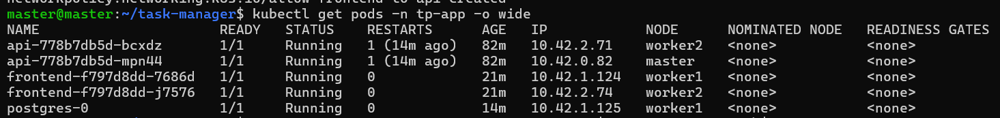

### E2 — Namespace, Quotas et LimitRange
Un namespace `tp-app` a été créé avec un `ResourceQuota` (limites globales) et un `LimitRange` (valeurs par défaut pour les conteneurs).
- **Commandes** : `kubectl apply -f k8s/05-quotas.yaml` et `kubectl describe quota -n tp-app`
- **Preuve** : 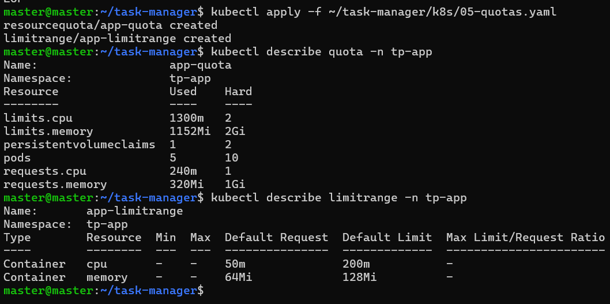

### E3 — Configuration externalisée
Les paramètres non sensibles sont dans un `ConfigMap` (`app-config`) et les identifiants dans un `Secret` (`db-credentials`).
- **Commande** : `kubectl get configmap,secret -n tp-app`
- **Preuve** : 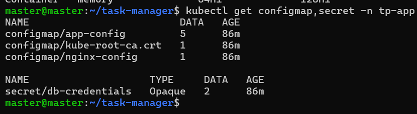

### E4 — Secrets (Git)
Aucun secret réel n'est versionné dans Git. Le fichier `secret.yaml` est dans le `.gitignore`, et un fichier modèle `secret.example.yaml` est fourni.
- **Commande** : `git status`
- **Preuve** : 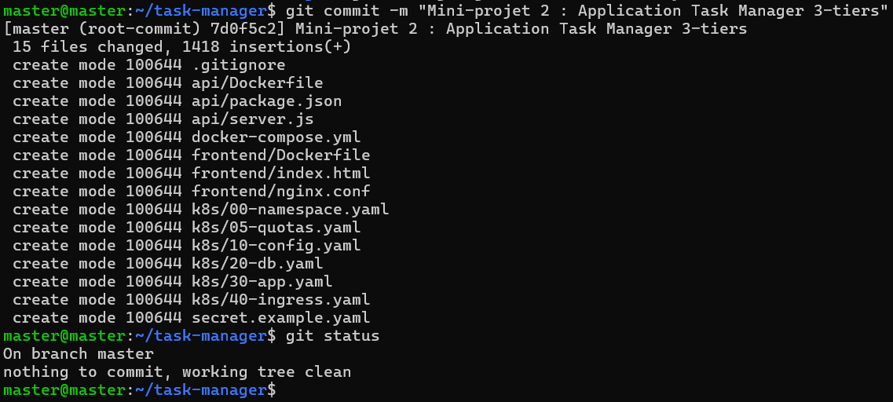

### E5 — Base de données (StatefulSet)
La base PostgreSQL est déployée via un `StatefulSet` avec un `volumeClaimTemplates` (PVC) et un Service headless.
- **Commande** : `kubectl get statefulset,pvc,pv -n tp-app`
- **Preuve** : 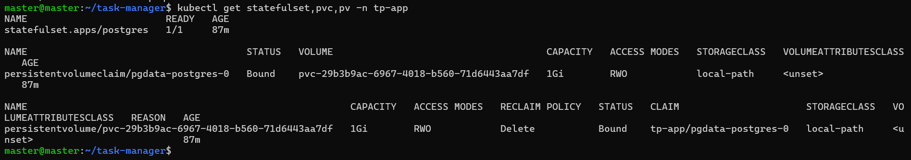

### E6 — Persistance
Les données survivent à la suppression du Pod de la base. J'ai supprimé le pod `postgres-0` et les données étaient toujours présentes.
- **Preuves** : 
  - Avant : 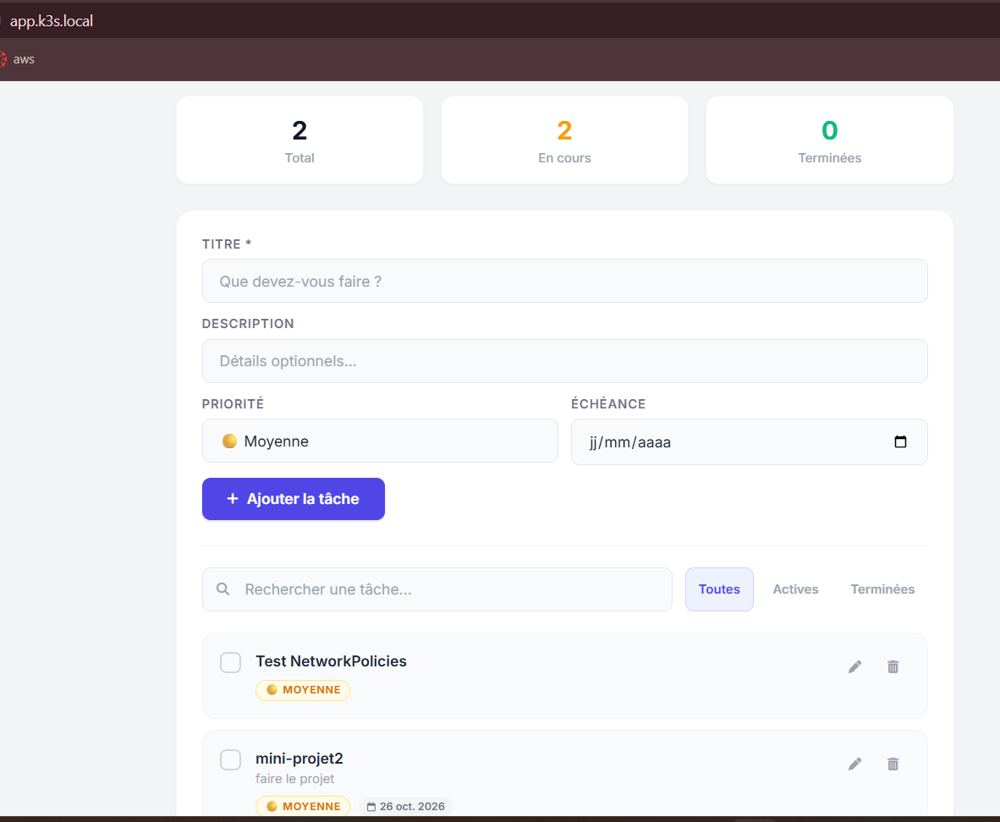
  - Suppression : 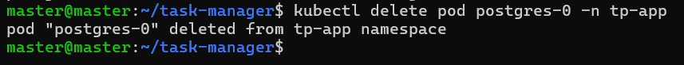
  - Après : 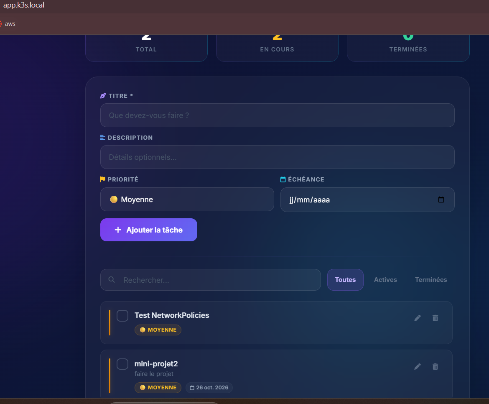

### E7 — Démarrage de l'API
L'API attend que la base soit prête grâce à une `readinessProbe` sur `/ready`.
- **Preuve** : Voir la preuve E8 (les sondes sont visibles dans la description du pod).

### E8 — Ressources
Chaque conteneur définit des `requests` et des `limits` (ex: API: 50m CPU / 64Mi RAM en request).
- **Commande** : `kubectl describe pod -n tp-app -l app=api | grep -A 5 "Limits|Requests"`
- **Preuve** : 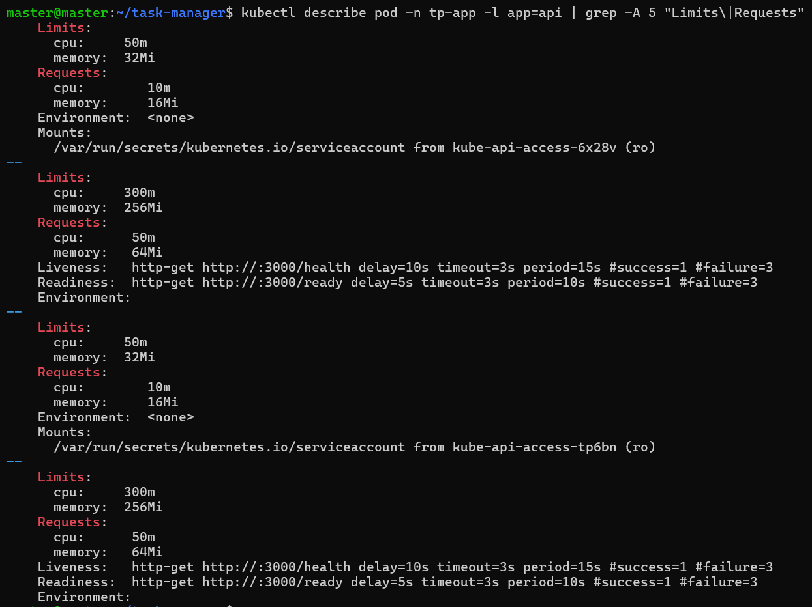

### E9 — Sondes (Probes)
L'API a une `readinessProbe` sur `/ready` et une `livenessProbe` sur `/health`.
- **Preuve** : Voir la capture E8.

### E10 — Exposition (Ingress)
Seul le frontend est exposé par un Ingress sur `app.k3s.local`.
- **Commande** : `kubectl get ingress -n tp-app`
- **Preuve** : 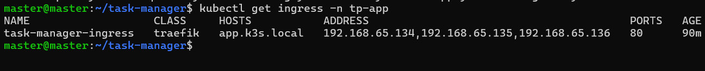

### E11 — Sauvegarde (CronJob)
Un CronJob `db-backup` sauvegarde la base sur un volume dédié (`backup-pvc`) toutes les 5 minutes.
- **Preuve** : *(Capture E11 à ajouter)*

### E12 — RBAC
Création d'un compte `dev-viewer` (ServiceAccount) avec un Role limité à la lecture dans le namespace.
- **Commandes** : `kubectl auth can-i list pods...` et `kubectl auth can-i delete pods...`
- **Preuves** : 
  - 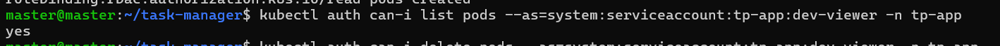
  - 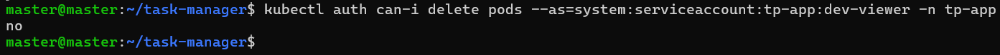

### E13 — Durcissement des Pods
L'API tourne en `runAsNonRoot` avec `allowPrivilegeEscalation: false` et les capabilities supprimées.
- **Commande** : `kubectl get pod -n tp-app -l app=api -o yaml | grep -A 5 "securityContext"`
- **Preuve** : 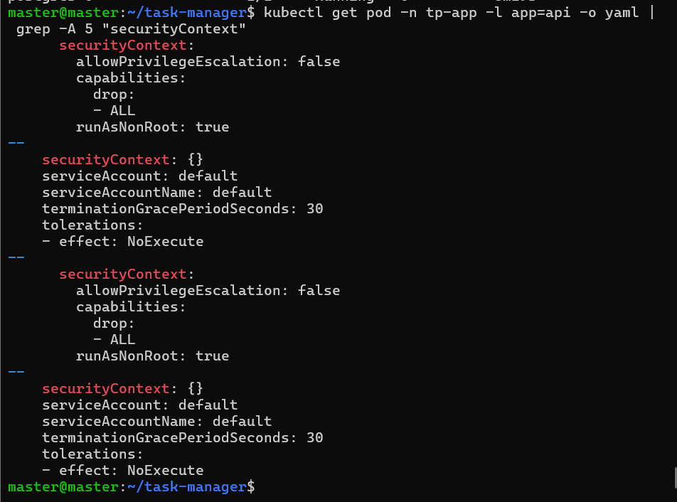

### E14 — NetworkPolicies
Mise en place d'un `default-deny-ingress`, puis autorisation des flux nécessaires (Traefik -> Frontend, Frontend -> API, API -> DB).
- **Commande** : `kubectl get networkpolicy -n tp-app`
- **Preuve** : 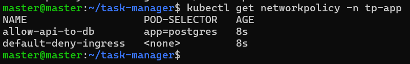
- **Application fonctionnelle** : 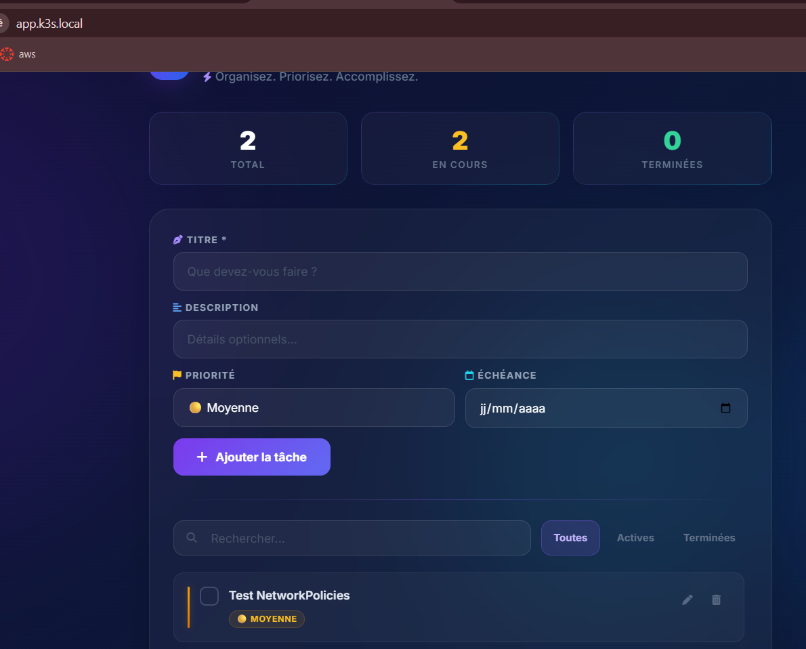

### E15 — Dépôt Git
Les manifestes sont rangés par dossier dans ce dépôt Git. Le fichier `README.md` est présent.
- **Preuve** : 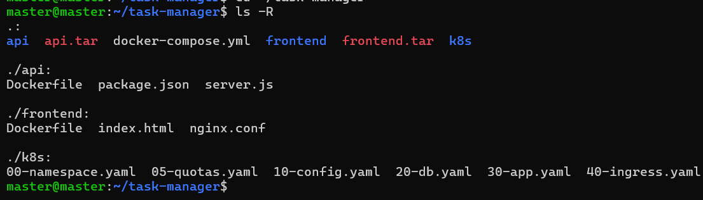

---

## Déploiement rapide

1. Construire les images :
   ```bash
   docker build -t taskmanager-api:latest ./api
   docker build -t taskmanager-frontend:latest ./frontend
